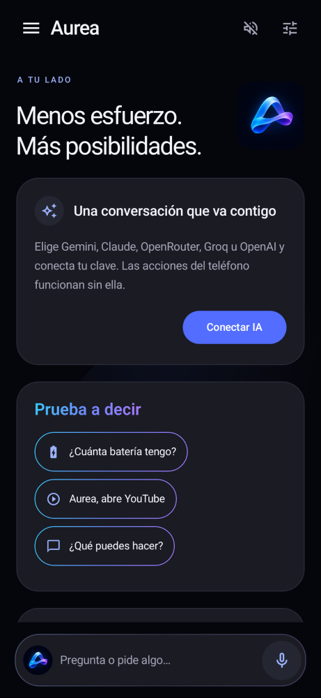
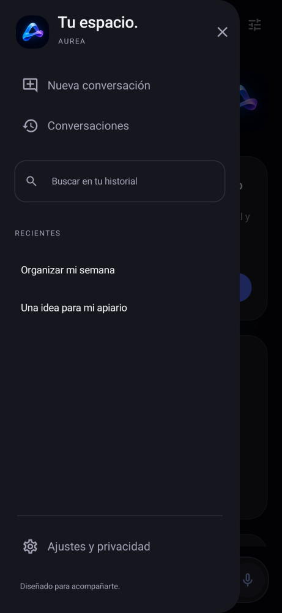
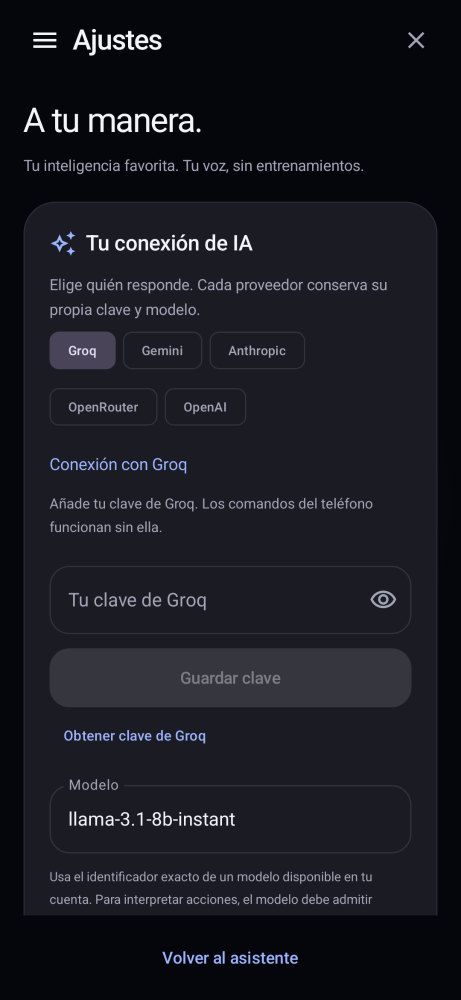

# Aurea · Inteligencia a tu manera

Asistente Android nativo en **Kotlin y Jetpack Compose**, antes llamado Asistente Pro.
Interfaz negra, icono propio azul/violeta, chat, menú lateral e historial local.

## Instalar Aurea 4.0.0

En **Actions → Aurea - Android nativo verificado**, abre la ejecución verde más reciente.
Descarga **asistente-pro-apk**, extrae el ZIP e instala **Aurea-4.0.0.apk**.
El ZIP también incluye el SHA-256 del APK. Android 8.0 o posterior; ARM y x86.

**Actualiza Asistente Pro 3.0.1 directamente**, conservando sus datos y su clave de Groq:
se mantiene `app.asistentepro.android` y el mismo certificado de firma. El nuevo nombre
que verás bajo el icono es **Aurea**. Las versiones antiguas con identificador
`org.asistentepro.asistentepro` siguen siendo independientes.

## Elige tu proveedor de IA

En **Ajustes → Tu conexión de IA**, elige **Gemini, Anthropic (Claude), OpenRouter,
Groq u OpenAI** y guarda tu clave. Cada proveedor conserva una clave cifrada y un
modelo independientes. Puedes cambiar el identificador del modelo por cualquiera
disponible en tu cuenta; los sugeridos pueden cambiar o requerir saldo.

Se usan los protocolos nativos de Gemini (`generateContent`) y Anthropic (`messages`),
y Chat Completions para Groq, OpenRouter y OpenAI. La app no incluye claves, créditos
ni suscripciones. Una clave guardada se valida con el proveedor al enviar una consulta.
La migración de la clave cifrada de Groq de la versión anterior es automática.

## «Aurea, abre YouTube» sin registrar tu voz

No hay entrenamiento de voz ni identificación de hablante. Puedes escribir o decir
«Aurea, abra la aplicación YouTube», «abre Spotify», «cuánta batería tengo»,
«enciende la linterna», «sube el volumen» o «pon alarma a las 7:00 AM».
Estos comandos **no necesitan una API de IA**. La app de destino debe estar instalada.

Para usarla **fuera de la app**:

1. Abre **Ajustes → Aurea, a tu lado** y activa **Manos libres**.
2. Concede micrófono y **Mostrar sobre otras apps**. Permite las notificaciones para
   tener a mano el botón **Detener**.
3. Con el modo activo, di **«Aurea»** y el comando. También puedes decir su nombre,
   esperar y hablar a continuación. Aparece una tarjeta flotante con la respuesta.
4. Opcionalmente, selecciona **Elegir como asistente de Android** para abrir su tarjeta
   con el gesto de asistencia de tu móvil. Este gesto no necesita permiso de superposición.

El reconocimiento de Manos libres es **local**, con Vosk y un modelo de español incluido
en el APK. No descarga un perfil personal ni guarda grabaciones. La primera activación
prepara el modelo y puede tardar unos segundos. Si hay una voz española de texto a voz
instalada en Android, Aurea también responde hablando.

La notificación y el interruptor permiten detener la escucha. No se reactiva por sí sola
tras reiniciar, forzar el cierre o matar el proceso. Mantener el micrófono activo consume
batería; el ahorro de energía de cada fabricante puede detenerlo. Desbloquea el teléfono
para abrir aplicaciones. La activación depende de reconocer la palabra en español y puede
fallar con ruido o pronunciaciones distintas. No tiene acceso al procesador de activación
exclusivo del fabricante ni sustituye las funciones privilegiadas de Siri/Bixby.

El botón del micrófono dentro de la app y el gesto de asistencia utilizan el mismo
reconocimiento local, mediante el protocolo de voz de Android. Alarmas, mensajes y otras acciones
se abren en las apps del sistema con las confirmaciones que Android requiera.

## Privacidad

Las claves se cifran mediante AES/GCM y Android Keystore, separadas por proveedor.
El historial y los borradores permanecen en el dispositivo. Al hacer una consulta de IA,
solo el proveedor seleccionado recibe el contexto necesario (hasta 24 mensajes recientes).
Manos libres procesa audio localmente; la superposición **no captura ni lee otras pantallas**.
No hay un servicio web o runtime Python/Kivy/Buildozer en el repositorio ni en el APK.

## Interfaz y pruebas

  

Actions publica el APK únicamente después de superar compilación, pruebas de contratos
HTTP de los cinco proveedores, comandos, renderizados, lint y pruebas instrumentadas en
**Android 11, Android 15 y Android 17**. Incluye instalación, actualización desde 3.0.1 cuando el
artefacto anterior sigue disponible, arranque, teclado, historial, claves separadas,
migración Groq, sesión del asistente del sistema y superposición desde fuera de la app.

La prueba de voz decodifica un audio español sintético real con Vosk; después entrega
esa hipótesis al mismo controlador utilizado por el micrófono y comprueba que abre una
app de verificación independiente sobre el launcher. Esa app se llama «YouTube (prueba)»
y **solo se instala en los emuladores**; no forma parte del APK distribuido ni suplanta
YouTube. Si la imagen del emulador trae YouTube preinstalado, el flujo lo desactiva
solo en ese dispositivo desechable para seleccionar la app de verificación de forma
determinista. La prueba no sustituye una prueba acústica con un teléfono y una persona.

El artefacto **asistente-pro-pruebas-android** incluye capturas, resultados y registros
por versión de Android. Las conexiones HTTP se prueban con servidor simulado; el acceso
real a cada cuenta requiere una clave y un modelo válidos del usuario.

En Android 17 se activa la comprobación estricta de audio en segundo plano y se verifica
que el volumen cambie realmente con Manos libres activo. El micrófono de ese modo se
inicia con la app visible, dentro de un servicio de primer plano de tipo microphone.
La compatibilidad de ejecución en Android 17 se prueba manteniendo compileSdk/targetSdk 35;
no se declara que la app use las nuevas APIs exclusivas del SDK 37.

## Compilar

JDK 17, SDK 35 y Gradle Wrapper incluidos en el flujo:

```sh
./gradlew :app:recordPaparazziDebug :app:lintDebug :app:assembleDebug :app:assembleDebugAndroidTest :verification-app:assembleDebug
./gradlew :app:connectedDebugAndroidTest
```

Gradle descarga el modelo español de Vosk 0.42 desde Alpha Cephei, comprueba su SHA-256
`09b239888f633ef2f0b4e09736e3d9936acfd810bc65d53fad45261762c6511f` y lo empaqueta.
El caché local `.speech-cache` está excluido de Git. El APK es mayor porque incluye
el reconocimiento sin conexión. Vosk y el modelo español se distribuyen bajo Apache 2.0;
se incluye la licencia en los assets de la app y el README original del modelo.

La firma estable está fijada en [`ci/signing.sha256`](ci/signing.sha256). El flujo recupera
el keystore y bloquea la publicación si falta o cambia. Para mantenimiento a largo plazo
el propietario debe respaldarlo en un almacén de secretos: esta conexión no permite
administrar secretos de Actions. Nunca se publica la clave privada de firma.
