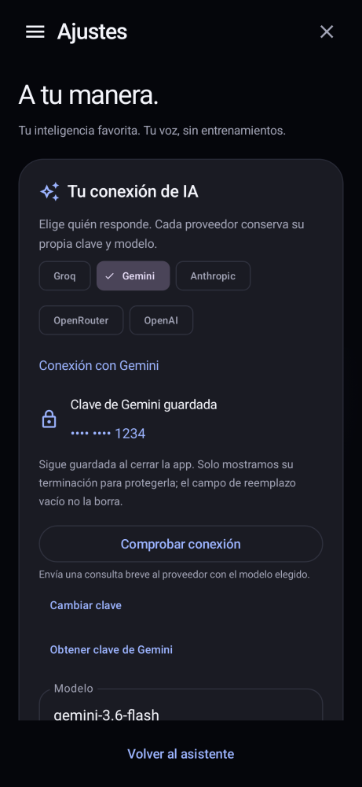

# Xylon · Inteligencia a tu manera

Asistente Android nativo en **Kotlin y Jetpack Compose**, antes llamado Asistente Pro.
Interfaz negra, icono propio azul/violeta, chat, menú lateral e historial local.

## Instalar Xylon 4.1.0

En **Actions → Xylon - Android 13 a 17 verificado**, abre la ejecución verde más reciente.
Descarga **asistente-pro-apk**, extrae el ZIP e instala **Xylon-4.1.0.apk**.
El ZIP también incluye el SHA-256 del APK. Android 8.0 o posterior; ARM y x86.

**Actualiza Xylon 4.0 o Asistente Pro 3.0.1 directamente, sin desinstalar**, conservando sus datos y claves:
se mantiene `app.asistentepro.android` y el mismo certificado de firma. El nuevo nombre
que verás bajo el icono es **Xylon**. Las versiones antiguas con identificador
`org.asistentepro.asistentepro` siguen siendo independientes.

## Elige tu proveedor de IA

En **Ajustes → Tu conexión de IA**, elige **Gemini, Anthropic (Claude), OpenRouter,
Groq u OpenAI** y guarda tu clave. Cada proveedor conserva una clave cifrada y un
modelo independientes. Puedes cambiar el identificador del modelo por cualquiera
disponible en tu cuenta; los sugeridos pueden cambiar o requerir saldo.

Se usan los protocolos nativos de Gemini (`generateContent`) y Anthropic (`messages`),
y Chat Completions para Groq, OpenRouter y OpenAI. La app no incluye claves, créditos
ni suscripciones. Una clave guardada se valida con el proveedor al enviar una consulta.
La migración de la clave cifrada de Groq de la versión anterior es automática.

Después de guardar verás **Clave guardada** con sus últimos cuatro caracteres. El campo
de reemplazo se cierra para proteger la clave; eso no la elimina. **Cambiar clave** abre
un formulario nuevo. Se comprueba tanto la escritura en disco como la lectura y descifrado
antes de confirmar el guardado. Si Android no puede descifrar una clave existente,
la app explica el problema y permite reemplazarla.

**Comprobar conexión** envía una consulta breve al proveedor con la clave y el modelo
elegidos. Un error de Internet, saldo, modelo o autenticación no borra la clave.
El valor inicial de Groq es `openai/gpt-oss-120b`; los antiguos valores Llama de
la versión 3 se actualizan porque Groq los retiró de sus cuentas normales.
Se conserva cualquier modelo personalizado. Gemini usa `gemini-3.6-flash`.
Referencias: [retiros de Groq](https://console.groq.com/docs/deprecations) y
[sustitución de Gemini 3.5](https://ai.google.dev/gemini-api/docs/models/gemini-3.5-flash).

## Háblale a tu manera

No hay entrenamiento de voz, registro de comandos ni frases obligatorias. Conecta una
clave y un modelo que admita funciones y expresa lo que necesitas de forma natural.
El proveedor decide si responde a una pregunta, continúa la conversación o solicita
una acción del teléfono mediante su API nativa de funciones. Xylon valida esa solicitud
y solo confirma una acción cuando Android la ejecuta o abre su pantalla de confirmación.

La conversación está abierta a cualquier tema. Las acciones disponibles abarcan abrir
cualquier app instalada, reloj y fecha reales del teléfono, batería, linterna, cámara,
ajustes de Wi-Fi, volumen, alarmas, temporizadores y abrir Mensajes. También hay
controles de navegación, brillo, rotación y reproducción descritos a continuación.
Sin una conexión de IA quedan disponibles atajos locales básicos; la interpretación
abierta de peticiones requiere la clave, un modelo compatible y conexión a Internet.

Las preguntas directas por la hora o fecha se resuelven con el reloj de Android,
incluso con una clave de IA configurada, sin conexión ni permisos adicionales. Cada
consulta de IA incluye además la fecha, hora y zona horaria actuales del dispositivo.

## Control del sistema

En **Ajustes → Control del sistema** puedes habilitar dos accesos independientes:

- **Configurar Accesibilidad**: en Android, activa **Xylon · control por voz**. Permite
  Inicio, Atrás, recientes, notificaciones, ajustes rápidos y bloqueo al pedirlos.
  El servicio no lee ventanas, no recopila eventos ni realiza acciones autónomas.
- **Permitir modificar ajustes**: activa la autorización para cambiar el brillo y la
  rotación automática. Xylon comprueba `Settings.System.canWrite()` antes de escribir.

Android puede bloquear inicialmente Accesibilidad para un APK instalado desde un gestor
de archivos. Si aparece **Ajuste restringido**, entra en **Información de la app → ⋮ →
Permitir ajustes restringidos** y vuelve a Accesibilidad. Estos accesos los concede y
revoca el usuario desde Android; la app no se los concede a sí misma.

También puedes establecer un porcentaje de volumen multimedia y enviar pausa/reproducción,
siguiente o anterior al reproductor activo. Wi-Fi, Bluetooth, ubicación, sonido y pantalla
se abren en los paneles del sistema para los cambios que requieran tu interacción.
El servicio no proporciona root ni permisos reservados al fabricante.

Referencias: [acciones de Accesibilidad](https://developer.android.com/reference/android/accessibilityservice/AccessibilityService#performGlobalAction(int))
y [modificación de ajustes](https://developer.android.com/reference/android/provider/Settings.System#canWrite(android.content.Context)).

Para usarla **fuera de la app**:

1. Abre **Ajustes → Xylon, a tu lado** y activa **Manos libres**.
2. Concede micrófono y **Mostrar sobre otras apps**. Permite las notificaciones para
   tener a mano el botón **Detener**.
3. Con el modo activo, di **«Xylon»** y habla con naturalidad. También puedes decir su nombre,
   esperar y hablar a continuación. Aparece una tarjeta flotante con la respuesta.
4. Opcionalmente, selecciona **Elegir como asistente de Android** para abrir su tarjeta
   con el gesto de asistencia de tu móvil. Este gesto no necesita permiso de superposición.

El reconocimiento de Manos libres es **local**, con Vosk y un modelo de español incluido
en el APK. No descarga un perfil personal ni guarda grabaciones. La primera activación
prepara el modelo y puede tardar unos segundos. Si hay una voz española de texto a voz
instalada en Android, Xylon también responde hablando.

La notificación y el interruptor permiten detener la escucha. No se reactiva por sí sola
tras reiniciar, forzar el cierre o matar el proceso. Mantener el micrófono activo consume
batería; el ahorro de energía de cada fabricante puede detenerlo. Desbloquea el teléfono
para abrir aplicaciones. La activación depende de reconocer la palabra en español y puede
fallar con ruido o pronunciaciones distintas. No tiene acceso al procesador de activación
exclusivo del fabricante ni sustituye las funciones privilegiadas de Siri/Bixby.

El botón del micrófono dentro de la app y el gesto de asistencia utilizan el mismo
reconocimiento local, mediante el protocolo de voz de Android. Alarmas, mensajes y otras acciones
se abren en las apps del sistema con las confirmaciones que Android requiera.

## Privacidad

Las claves se cifran mediante AES/GCM y Android Keystore, separadas por proveedor.
El historial y los borradores permanecen en el dispositivo. Al hacer una consulta de IA,
solo el proveedor seleccionado recibe el contexto necesario (hasta 24 mensajes recientes).
Ese contexto incluye el reloj y la zona horaria del dispositivo, sin consultar ubicación GPS.
Manos libres procesa audio localmente; la superposición **no captura ni lee otras pantallas**.
No hay un servicio web o runtime Python/Kivy/Buildozer en el repositorio ni en el APK.

## Interfaz y pruebas

  



Actions publica el APK únicamente después de superar compilación, pruebas de contratos
HTTP de los cinco proveedores, comandos, renderizados, lint y pruebas instrumentadas en
**Android 13, 14, 15, 16 y 17**. Los cinco entornos instalan el mismo APK y ejecutan
once pruebas instrumentadas mediante AndroidJUnitRunner y otras dos fases de persistencia
en procesos diferentes. Incluye instalación, actualización desde 4.0 y desde 3.0.1 cuando el
artefacto anterior sigue disponible, arranque, teclado, historial, claves separadas,
migración Groq, sesión del asistente del sistema y superposición desde fuera de la app.
Las cinco claves y un historial de prueba se guardan, se fuerza el cierre real del proceso
y se verifican de nuevo, incluyendo un PID distinto. También se comprueba la recuperación
de una clave ilegible, la hora local con una clave configurada y los cambios reales de
brillo/rotación y navegación Inicio mediante el servicio de Accesibilidad.
Solo los emuladores desechables reciben permisos mediante comandos de CI; el APK
distribuido requiere la activación manual en los ajustes de Android.

Las pruebas HTTP comprueban respuestas de texto y funciones nativas de los cinco
proveedores, además de rechazar funciones desconocidas y argumentos inválidos.
El texto normal de una respuesta nunca se ejecuta como una instrucción del teléfono.
La prueba de voz decodifica un audio español sintético real con Vosk; después entrega
esa hipótesis al mismo controlador utilizado por el micrófono y comprueba que abre una
app de verificación independiente sobre el launcher. Esa app se llama «YouTube (prueba)»
y **solo se instala en los emuladores**; no forma parte del APK distribuido ni suplanta
YouTube. Si la imagen del emulador trae YouTube preinstalado, el flujo lo desactiva
solo en ese dispositivo desechable para seleccionar la app de verificación de forma
determinista. La prueba no sustituye una prueba acústica con un teléfono y una persona.

El artefacto **asistente-pro-pruebas-android** incluye capturas, resultados y registros
por versión de Android, incluido el registro completo de instrumentación y el hash del
APK probado. Las conexiones HTTP se prueban con servidor simulado; el acceso
real a cada cuenta requiere una clave y un modelo válidos del usuario.

En Android 17 se activa la comprobación estricta de audio en segundo plano y se verifica
que el volumen cambie realmente con Manos libres activo. El micrófono de ese modo se
inicia con la app visible, dentro de un servicio de primer plano de tipo microphone.
La compatibilidad de ejecución en Android 17 se prueba manteniendo compileSdk/targetSdk 35;
no se declara que la app use las nuevas APIs exclusivas del SDK 37.
Los emuladores usan Command-line Tools 22 y se comprueba que el de Android 17 registre
la plataforma real `android-37.0`; las herramientas antiguas del runner pueden generar
por error `android-0` y provocar un fallo de SurfaceFlinger antes de instalar la app.

## Compilar

JDK 17, SDK 35 y Gradle Wrapper incluidos en el flujo:

```sh
./gradlew :app:recordPaparazziDebug :app:lintDebug :app:assembleDebug :app:assembleDebugAndroidTest :verification-app:assembleDebug
./gradlew :app:connectedDebugAndroidTest
```

Gradle descarga el modelo español de Vosk 0.42 desde Alpha Cephei, comprueba su SHA-256
`09b239888f633ef2f0b4e09736e3d9936acfd810bc65d53fad45261762c6511f` y lo empaqueta.
El caché local `.speech-cache` está excluido de Git. El APK es mayor porque incluye
el reconocimiento sin conexión. Vosk y el modelo español se distribuyen bajo Apache 2.0;
se incluye la licencia en los assets de la app y el README original del modelo.

La firma estable está fijada en [`ci/signing.sha256`](ci/signing.sha256). El flujo recupera
el keystore y bloquea la publicación si falta o cambia. Para mantenimiento a largo plazo
el propietario debe respaldarlo en un almacén de secretos: esta conexión no permite
administrar secretos de Actions. Nunca se publica la clave privada de firma.
