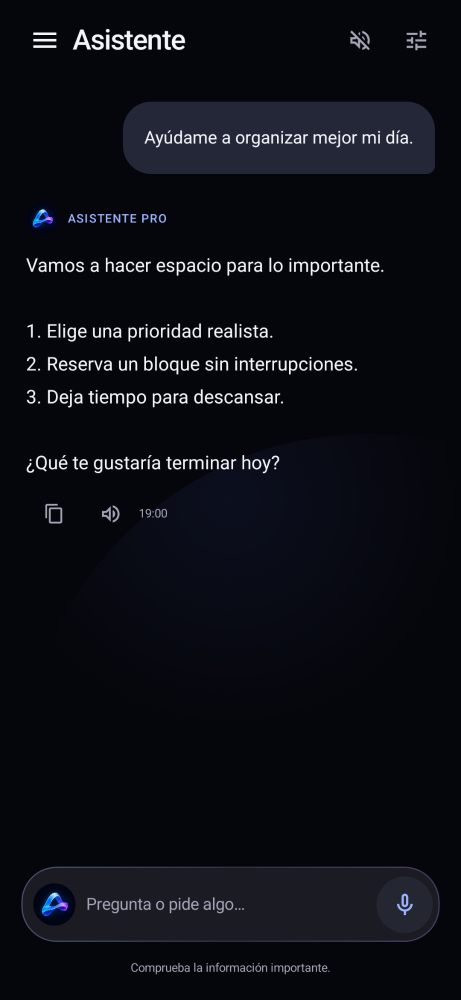

# Asistente Pro · Android nativo

Aplicación Android en **Kotlin y Jetpack Compose**. Interfaz negra con acentos azul/violeta,
icono propio, menú lateral, historial buscable, chat, voz de Android y acciones del teléfono.
El repositorio activo ya no contiene Python, Kivy, Flask ni Buildozer. Las versiones antiguas
se conservan exclusivamente en el historial de Git.

## Instalar la reconstrucción 3.0.1

Abre la ejecución verde más reciente de **Actions → Asistente Pro - Android nativo verificado**.
Descarga **asistente-pro-apk**, descomprime e instala **AsistentePro-Nativo-3.0.1.apk**.
Android 8.0 o posterior; ARM y x86. Abre el icono azul/violeta nuevo.

Esta app tiene el identificador independiente **`app.asistentepro.android`**. Puede coexistir
con `org.asistentepro.asistentepro`, evitando el conflicto entre las firmas de los APK
antiguos. **No necesitas borrar los datos ni desinstalar la versión antigua.** Las apps
son independientes y Android no permite leer automáticamente los datos privados de la otra.

## Ver la interfaz

  

[Icono nuevo](docs/previews/icono.png) · [Ajustes](docs/previews/ajustes.png).
Las capturas renderizadas se complementan con capturas y pruebas de una instalación real
en el emulador de Android publicadas por Actions.

## Qué hace

- Chat con Groq y contexto de la conversación, cancelación, copiar y leer respuestas.
- Voz al tocar el micrófono mediante el servicio de reconocimiento de Android.
- Menú lateral con búsqueda, conversaciones guardadas y eliminación de historial.
- Borrador conservado localmente para retomar lo que estabas escribiendo.
- Clave de Groq cifrada con Android Keystore; nunca se incluye una clave de IA en el APK.
- Acciones nativas sin clave de IA: batería, linterna, cámara, ajustes Wi-Fi, volumen,
  abrir apps instaladas, alarmas, temporizadores y abrir mensajes.
- Ejemplos: «cuánta batería tengo», «enciende la linterna», «abre Spotify»,
  «sube el volumen», «pon alarma a las 7:00 AM», «temporizador de 5 minutos».

Los temporizadores, alarmas y mensajes se abren en las apps del sistema y Android puede
pedir confirmación. No hay escucha permanente, palabra de activación ni cierre forzoso
de otras apps. La disponibilidad de voz y funciones depende de permisos, hardware y
servicios instalados; no se simulan acciones ejecutadas.

Para consultas de IA abre **Ajustes**, obtén una clave en <https://console.groq.com/keys>
y guárdala. Los últimos mensajes necesarios se envían a Groq; el historial permanece
en el dispositivo. No se transfiere automáticamente la clave de instalaciones antiguas.

## Verificar y compilar

JDK 17, Android SDK 35, Gradle Wrapper incluido:

```sh
./gradlew :app:recordPaparazziDebug :app:lintDebug :app:assembleDebug
./gradlew :app:connectedDebugAndroidTest
```

Actions comprueba la ausencia del runtime anterior, la firma del APK, los comandos,
peticiones y errores de Groq, renderizado en diferentes tamaños y pruebas instrumentadas
de instalación/actualización/arranque, menú, teclado, batería e historial en Android API 30 y 35.
También comprueba coexistencia con el APK 2.0 cuando su artefacto sigue disponible.
El APK se publica **después** de pasar la prueba en el dispositivo virtual.

La firma de distribución de pruebas tiene la huella SHA-256
`305170c9d2d00d1739c9e1ce6f0d91f69707a2a816ed1a76de2c976d66027895`.
El flujo recupera el keystore existente y bloquea la publicación si falta o cambia.
Para mantenimiento a largo plazo el propietario debe respaldar ese keystore en un
almacén de secretos: la conexión usada en esta reconstrucción no permite administrar
secretos de Actions. Nunca se guarda una clave privada de firma en el repositorio.
